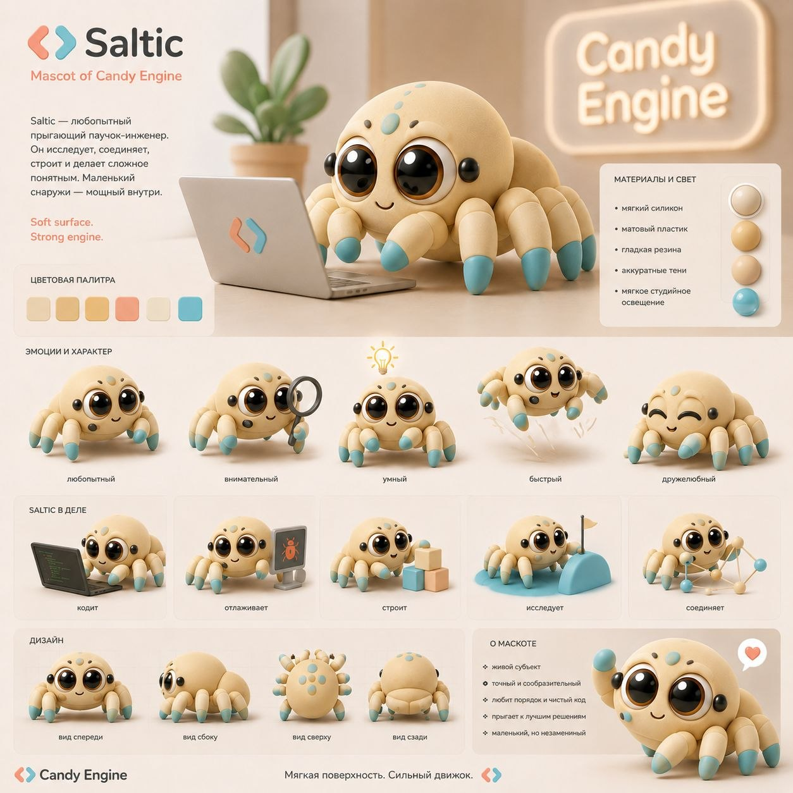

<p align="center">
  
</p>

# Saltic

**Текущая версия: 211:59:209**

Saltic — системный язык, который собирает сам себя: парсер, чекер и
компилятор написаны на самом Saltic, выдают машинный код RISC-V и x86-64 без
LLVM и без C. На нём же написана ОС, которая живёт на настоящем ноутбуке через
UEFI — с драйвером сети, своим сетевым стеком, библиотекой интерфейса и
программами.

Имя — от **Salticidae**, пауков-скакунов: маленьких, с лучшим зрением среди
пауков, точных в прыжке. Латинское *saltare* — «прыгать» и «танцевать»,
поэтому цикл в Saltic — барабан (`drum`), а шаг — удар (`beat`). Подробнее —
[docs/laws/ORIGIN.md](docs/laws/ORIGIN.md).

Saltic делается одним автором для себя и своих агентов: автор принимает
решения, агенты их исполняют. Один способ сделать каждую вещь, никаких тихих
ошибок, язык однажды замёрзнет — и программы на нём будут жить годами.

## В цифрах

- Самосборка — **5,7 с и 89 МБ**, компилятор — 2,6 МБ (эталон rv32i, паспорт
  полки 172:53:165; вечером 02.11.2026 было 16,9 с и 1,19 ГБ). Неподвижная
  точка: второе и третье поколения компилятора совпадают байт в байт.
- **15 ключевых слов** (у Lua — 22, у Go — 25, у C — 32).
- fib(40) — 0,88 с на родном x86-64: быстрее Ruby с YJIT, PHP с JIT, Lua и
  Python; впереди C, LuaJIT и Node. Таблицы и методика —
  [docs/numbers/BENCHMARKS.md](docs/numbers/BENCHMARKS.md).
- Запуск программы — 0,2 мс.

## Как выглядит

```saltic
use io
use core.group

State = enum {
    READY,
    ACTIVE,
    TIRED
}

Actor = Box {
    name = "pip",
    state = State.READY,
    energy = 100
}

skill spend(actor, cost) {
    (cost > actor.energy) { out error.NotEnoughEnergy }
    out Actor { name = actor.name, state = State.ACTIVE, energy = actor.energy - cost }
}

skill try_spend(actor, cost) {
    @next = spend(actor, cost) rescue |err| {
        io.show("{err}: нужно {cost}")
        out Actor { name = actor.name, state = State.TIRED, energy = actor.energy }
    }
    out next
}

program() {
    @actor = Actor { energy = 30 }
    @costs = [5, 7, 40]
    drum (group.count(costs)) {
        @cost = group.get(costs, beat)
        actor = try_spend(actor, cost)
    }
    @name = actor.name
    @energy = actor.energy
    io.show("{name}: осталось {energy}")
    (actor.state == State.TIRED) { io.show("{name} устал") }
    out none
}
```

```
NotEnoughEnergy: нужно 40
pip: осталось 18
pip устал
```

`@` — новая переменная, `out` — результат навыка, ошибки — значения с именем
(`error.NotEnoughEnergy`), `rescue` ловит их на месте. Эталон всех
возможностей языка — канон [soul/canonical/](soul/canonical/).

## Что уже работает

- **Компилятор** — родной код RV32I, RV64 и x86-64; программы для Linux
  (rv32i, rv64, x86-64), голого RISC-V (qemu-virt) и UEFI.
- **ОС на qemu-virt** — лаунчер, змейка, пианино со звуком, колония
  (`just qemu-graphics`).
- **Acer Aspire E5-575G через UEFI** — агент на диске, управление по кабелю,
  драйвер Ethernet RTL8111 и свой стек (ARP, IPv4, UDP), драйвер Wi-Fi QCA9377
  до `SERVICE_READY`, UIEngine (около 60 компонентов в духе shadcn, JTML),
  программы WIRE, TASKS, CareOS, трассировщик лучей, фрактал.
- **Язык** — группы-деревья, буфер байтов `core.bytes`, фиксированные типы
  `u8…usize`, `bits32`, `address`, регионы памяти, ошибки по имени.

## Быстрый старт

Окружение зафиксировано через Nix:

```bash
nix --extra-experimental-features "nix-command flakes" develop
```

- `just global-check` — проверка всего: самосборка с паспортами (неподвижная
  точка rv64, x86-64 и rv32i родными компиляторами), затем разом тесты `all`
  на rv32i, x86-64 и RV64, тесты ОС `os`, платформы (qemu-virt, UEFI, closure),
  самосборка на RV64 и кодировщик x86 — карточками со случаями каждой ветки;
- `just rv64` — доказательство: эталон RV64 собирает себя под `qemu-riscv64`
  (около минуты; перед релизом);
  (группы тестов — [docs/process/TESTING.md](docs/process/TESTING.md));
- `just qemu-graphics` — ОС с программами в окне QEMU.

Собрать свою программу компилятором с полки:

```bash
bootstrap/saltic-*-compiler-x86_64-linux hello.saltic hello 134217728 x86_64
```

Под RISC-V 64 (канон RVA23) — та же команда с целью `rv64`, запуск под QEMU:

```bash
bootstrap/saltic-*-compiler-x86_64-linux hello.saltic hello 134217728 rv64
qemu-riscv64 -B 0x100000000 ./hello
```

## Документы

- [docs/plan/PLAN.md](docs/plan/PLAN.md) — чек-лист задач сверху вниз (План 2);
  [docs/plan/PLAN-3.md](docs/plan/PLAN-3.md) — ОС, инструменты, скорость, железо: ждёт, пока
  План 2 не завершён;
  [docs/plan/QUESTIONS.md](docs/plan/QUESTIONS.md) и [docs/plan/ANSWERS.md](docs/plan/ANSWERS.md) —
  вопросы к автору и его ответы; прежний план с дорогой по эпохам и двумя
  свистками — [.archive/docs/PLAN-1.md](.archive/docs/PLAN-1.md);
- [CHANGELOG.md](CHANGELOG.md) — история релизов, [VERSION](VERSION) — номер;
- [docs/process/FOOTBALL.md](docs/process/FOOTBALL.md) — версия как счёт матча «фичи : баги :
  уборка»;
- [docs/numbers/BENCHMARKS.md](docs/numbers/BENCHMARKS.md) — скорость среди других языков и
  наши компиляторы;
- [docs/laws/MISSION.md](docs/laws/MISSION.md), [docs/laws/ORIGIN.md](docs/laws/ORIGIN.md),
  [docs/laws/PHILOSOPHY.md](docs/laws/PHILOSOPHY.md) — зачем и откуда;
- [docs/os/OS-core.md](docs/os/OS-core.md) — понимание ОС;
- [docs/process/Code_Architecture_канон_для_агентов.md](docs/process/Code_Architecture_канон_для_агентов.md)
  и [AGENTS.md](AGENTS.md) — правила для агентов;
- [.archive/docs/history/](.archive/docs/history/) — летопись по дням,
  [.archive/docs/fable/](.archive/docs/fable/) — отчёты агента Fable (разобраны,
  несделанное — в чек-листе); разведка — [docs/plan/RECON.md](docs/plan/RECON.md),
  открытые вопросы — [docs/plan/QUESTIONS.md](docs/plan/QUESTIONS.md).

## Релиз

1. `just release-draft` предложит счёт и черновик по префиксам коммитов;
   проверить по [docs/process/FOOTBALL.md](docs/process/FOOTBALL.md) — фичи, баги и уборку —
   и записать счёт в `VERSION`, `README.md` и `CHANGELOG.md`.
2. `just global-check` — компиляторы на полке получат имя новой версии и
   паспорта, заодно пройдут все хосты и платформы.
3. Закоммитить `release: Saltic F:B:C`, вместе с обоими компиляторами
   (эталон RV64 и родной x86-64).
4. Аннотированный тег: `git tag -a vF.B.C -m "Saltic F:B:C — название"`.
5. `git push origin master --follow-tags`.

GitHub Actions сверит тег с `VERSION`, возьмёт описание из `CHANGELOG.md`,
соберёт SDK и опубликует GitHub Release.

## Bootstrap

На полке [bootstrap/](bootstrap/) — компилятор
`saltic-<версия>-compiler-rv64-linux` (эталон, канон RV64, собирает сам себя)
и его родная версия `saltic-<версия>-compiler-x86_64-linux`; у каждого паспорт
`.txt`: кто собрал, из каких исходников, размер, время и пик памяти.
Компилятор для RV32I (`…-compiler-rv32i-linux.elf`, вторая сверка неподвижной
точки) и для голого RISC-V (`…-for-qemu_virt.elf`) выводятся из них локально
и в git не лежат. `SALTIC_NATIVE=0` возвращает запуск эталона под
`qemu-riscv64`.

## Лицензия

Saltic является закрытым программным обеспечением. Приватное тестирование
разрешено только людям, которым правообладатель явно предоставил доступ.
Условия: [русский текст](LICENSE.ru) и [английский перевод](LICENSE).
