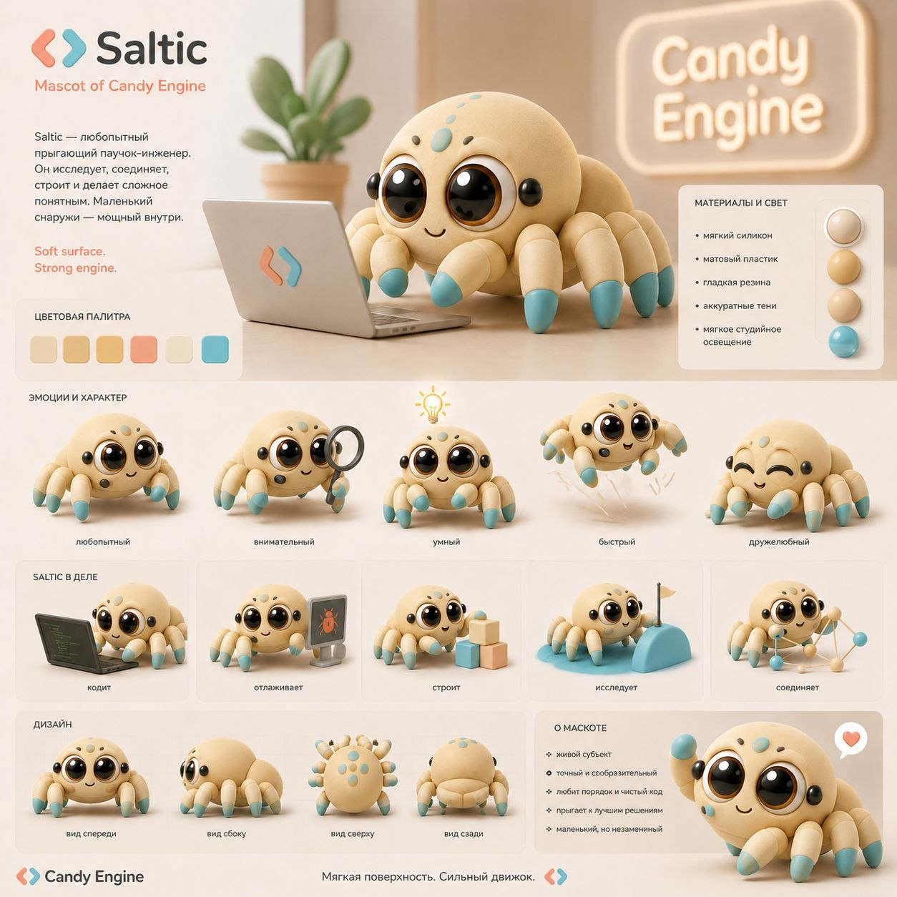

<p align="center">
  
</p>

# Saltic

**Текущая версия: 324:84:333**

Saltic — системный язык, который собирает сам себя: парсер, чекер и
компилятор написаны на самом Saltic и выдают машинный код без LLVM и без C —
для RISC-V (RV32I, RV64), x86-64, ARM64, Xtensa (ESP32) и WebAssembly. На нём
же написаны драйверы и программы: стенд на ноутбуке Acer через UEFI (свой
сетевой стек, Wi-Fi, видеокарта), APK для Android, программы на плате ESP32 и
окна на Linux. Своей ОС пока нет — её замысел автор собирает заново.

Имя — от **Salticidae**, пауков-скакунов: маленьких, с лучшим зрением среди
пауков, точных в прыжке. Латинское *saltare* — «прыгать» и «танцевать»,
поэтому цикл в Saltic — барабан (`drum`), а шаг — удар (`beat`). Подробнее —
[docs/laws/ORIGIN.md](docs/laws/ORIGIN.md).

Saltic делается одним автором для себя и своих агентов: автор принимает
решения, агенты их исполняют. Один способ сделать каждую вещь, никаких тихих
ошибок, язык однажды замёрзнет — и программы на нём будут жить годами.

## В цифрах

- Самосборка родным x86-64 — **34 с и 168 МБ**, компилятор — 2,7 МБ
  (global-check 22.11.2026). Неподвижная точка: второе и третье поколения
  компилятора совпадают байт в байт (rv64, arm64; полка x86-64).
- **15 ключевых слов** (у Lua — 22, у Go — 25, у C — 32).
- fib(40) на родном x86-64 — 1,30 с (22.11.2026; 06.11.2026 было 0,88 с).
  Таблицы среди других языков и методика —
  [docs/numbers/BENCHMARKS.md](docs/numbers/BENCHMARKS.md).

## Как выглядит

```saltic
use io

Actor = Box {
    name = "pip",
    state = State.READY,
    energy = 100

    State = enum {
        READY,
        ACTIVE,
        TIRED
    }

    skill spend(cost) {
        (cost > energy) {
            out error.NotEnoughEnergy
        }
        energy = energy - cost
        state = State.ACTIVE
        out none
    }

    skill try_spend(cost) {
        spend(cost) rescue |err| {
            io.show("{err}: нужно {cost}")
            state = State.TIRED
        }
        out none
    }
}

program() {
    @actor = Actor {
        energy = 30
    }
    drum ([5, 7, 40]) {
        actor.try_spend(beat)
    }
    io.show("{actor.name}: осталось {actor.energy}")
    (actor.state == Actor.State.TIRED) {
        io.show("{actor.name} устал")
    }
    out none
}
```

```
NotEnoughEnergy: нужно 40
pip: осталось 18
pip устал
```

Навык всегда чей-то — метод своего Box; поля Box метод видит по имени. `@` —
новая переменная, `out` — результат навыка, ошибки — значения с именем
(`error.NotEnoughEnergy`), `rescue` ловит их на месте, цикл — барабан `drum`,
шаг — `beat`. Эталон всех возможностей языка — канон
[soul/canonical/](soul/canonical/).

## Что уже работает

- **Компилятор** — родной код RV32I, RV64, x86-64, ARM64, Xtensa и wasm32;
  цели: Linux (rv32i, rv64, x86-64, arm64), UEFI, голый qemu-virt, Android
  (APK без NDK), ESP32, wasm под Node и в браузере.
- **Стенд Acer Aspire E5-575G через UEFI** — агент на диске, управление по
  кабелю и mRPC, драйвер Ethernet RTL8111 и свой стек (ARP, IPv4, UDP), Wi-Fi
  QCA9377 до `SERVICE_READY`, блиттер видеокарты Intel.
- **Программы** (репозиторий [saltic-soft](https://github.com/zephyr-m/saltic-soft)) — «Сцена», «Бастион», SalticIDE, Полигон, почта,
  алхимия языка, доска задач, биржа, взгляд на телефоне, куб на ESP32, игры
  стола qemu-virt.
- **Интерфейс** — JTML (пять атомов) и закрытая библиотека жителей UIEngine по
  этажам, темы, шрифты TTF.
- **Пакеты** — реестр `saltic-registry` (адаптеры и библиотеки с паспортами и
  версиями) и пакетный менеджер tarantul.
- **Язык** — группы-деревья, буфер байтов `core.bytes`, фиксированные типы
  `u8…usize`, `bits32`, `address`, регионы памяти без сборщика мусора, запрет
  циклов ссылок, ошибки по имени, законы архитектора.

## Где что лежит

```
soul/seed/        семя: core, io, proof и compiler (библиотека без входа)
soul/toolchains/  сборщики целей: saltic (полка), qemu_virt, android, esp32, wasm
soul/canonical/   эталон языка        soul/craft/   инструменты языка
workbench/        инструменты разработки: проверки, lens, Acer, tarantul
tests/  bootstrap/  formats/  docs/
```

Библиотеки и адаптеры (графика, шрифты, ввод, UIEngine, драйверы, прошивка
UEFI, окно Wayland) — в реестре; `just tarantul` привозит их в `tarantul/`,
программы пишут `use tarantul.<пакет>.…`. Сами программы — в
[saltic-soft](https://github.com/zephyr-m/saltic-soft), он берёт язык и полку отсюда (`SALTIC_HOME`).

## Быстрый старт

Окружение зафиксировано через Nix:

```bash
nix --extra-experimental-features "nix-command flakes" develop
```

- `just global-check` — проверка на родном хосте: лимиты, самосборка полки
  x86-64, тесты x86-64 и библиотек, кодировщики x86-64, ARM64 и ESP32, wasm —
  карточками со случаями каждой ветки;
- `just hosts` — чужие хосты под QEMU, перед релизом: тесты на rv32i, RV64 и
  ARM64, платформы (qemu-virt, UEFI), программы под чужие процессоры (звенья,
  RVA23, канон RV64 и ARM64, машинный слой RV32I), самосборка RV64 и ARM64;
- `just test` — тесты (группы — [docs/process/TESTING.md](docs/process/TESTING.md));
- `just entries` — все входы проекта через чекер, без сборки.

Собрать свою программу компилятором с полки:

```bash
bootstrap/saltic hello.saltic hello 134217728 x86_64
```

Под RISC-V 64 (канон RVA23) — та же команда с целью `rv64`, запуск под QEMU:

```bash
bootstrap/saltic hello.saltic hello 134217728 rv64
qemu-riscv64 -B 0x100000000 ./hello
```

## Документы

- [docs/plan/PLAN.md](docs/plan/PLAN.md) — чек-лист открытого (План 2),
  сделанное — [docs/plan/DONE.md](docs/plan/DONE.md);
  [docs/plan/PLAN-3.md](docs/plan/PLAN-3.md) — ОС, инструменты, скорость, железо;
  [docs/plan/GREAT-REFACTOR.md](docs/plan/GREAT-REFACTOR.md) — дорога языка до
  скорости; вопросы и ответы автора —
  [QUESTIONS](docs/plan/QUESTIONS.md), [ANSWERS](docs/plan/ANSWERS.md);
- [docs/laws/](docs/laws/) — законы: [принципы](docs/laws/PRINCIPLES.md),
  [миссия](docs/laws/MISSION.md), [откуда](docs/laws/ORIGIN.md),
  [философия](docs/laws/PHILOSOPHY.md), [архитектура](docs/laws/ARCHITECTURE.md);
- [docs/language/](docs/language/) — модель памяти, метроном, конечный автомат,
  типы данных;
- [docs/os/OS-core.md](docs/os/OS-core.md) — замысел ОС;
  [docs/hardware/boards/](docs/hardware/boards/) — платы;
- [docs/process/Code_Architecture_канон_для_агентов.md](docs/process/Code_Architecture_канон_для_агентов.md)
  и [AGENTS.md](AGENTS.md) — правила для агентов;
  [docs/process/FOOTBALL.md](docs/process/FOOTBALL.md) — версия как счёт матча;
- [CHANGELOG.md](CHANGELOG.md) — история релизов, [VERSION](VERSION) — номер;
- [.archive/docs/](.archive/docs/) — прежние документы и летопись по дням.

## Релиз

1. `just release-draft` предложит счёт и черновик по префиксам коммитов;
   проверить по [docs/process/FOOTBALL.md](docs/process/FOOTBALL.md) — фичи, баги и уборку —
   и записать счёт в `VERSION`, `README.md` и `CHANGELOG.md`.
2. `just bootstrap-refresh` — компиляторы на полке получат имя новой версии и
   паспорта; потом `just global-check` (родной хост) и `just hosts` (чужие
   хосты и платформы).
3. Закоммитить `release: Saltic F:B:C`, вместе с обоими компиляторами
   (эталон RV64 и родной x86-64).
4. Аннотированный тег: `git tag -a vF.B.C -m "Saltic F:B:C — название"`.
5. `git push origin master --follow-tags`.

GitHub Actions сверит тег с `VERSION`, возьмёт описание из `CHANGELOG.md`,
соберёт SDK и опубликует GitHub Release.

## Bootstrap

На полке [bootstrap/](bootstrap/) — компилятор
`saltic-<версия>-compiler-rv64-linux` (эталон, канон RV64, собирает сам себя)
и его родная версия `saltic-<версия>-compiler-x86_64-linux`; оба собраны из
сборщика `soul/toolchains/saltic`. У каждого паспорт `.txt`: кто собрал, из
каких исходников, размер, время и пик памяти. Компилятор для RV32I и для
голого RISC-V (qemu-virt) выводятся из них локально и в git не лежат.
`bootstrap/saltic` — запуск родного с полки; `SALTIC_NATIVE=0` возвращает
запуск эталона под `qemu-riscv64`.

## Лицензия

Saltic — открытое программное обеспечение по лицензии
[Apache License 2.0](LICENSE) (с 11.11.2026). Юридически действует
английский текст; [краткое изложение по-русски](LICENSE.ru) — для удобства.
Прежняя закрытая лицензия — в `.archive/legal/`.
