# 1 ноября 2026: Saltic на голом железе

За один вечер Saltic прошёл путь от программы «Hello» на флешке до системы,
которая загружается с диска ноутбука, размеченного ею самой, говорит по
проводу, принимает программы и рисует по-русски своим шрифтом.

Ноутбук — Acer Aspire E5-575G (Intel Core i5 седьмого поколения, 2016 год),
на котором раньше стояла самодельная система неизвестного происхождения.
Второй ноутбук — рабочий, на нём компилятор Saltic и Claude. Между ними — один
кабель Ethernet, без роутера.

## 19:50 — первая загрузка

Флешка с Ventoy, программа `hello.saltic` под UEFI. Первая попытка «ничего не
показала»: Enter, которым выбирали пункт в меню Ventoy, остался в буфере
клавиатуры, программа приняла его за ответ и тут же вышла. Отладочная версия,
которая ждёт пробел и никогда не выходит, показала: Saltic работает на
настоящем железе и читает клавиатуру.

## 20:31 — Saltic прочитал железо

Системная таблица UEFI → ACPI RSDP → XSDT → MCFG → ECAM → обход всех шин PCI.
Девятнадцать устройств, среди них Ethernet Realtek RTL8111 (`10ec:8168`) и Wi-Fi
Qualcomm Atheros QCA9377 (`168c:0042`).

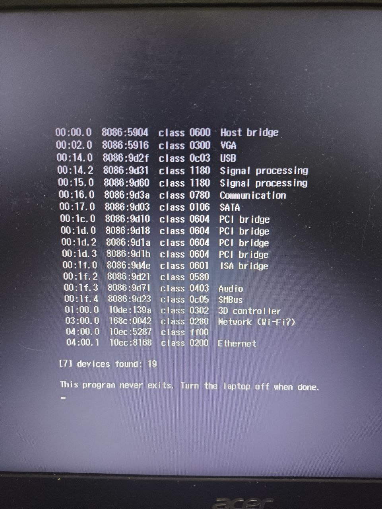

## 20:55 — свой драйвер сетевой карты, шаг 1

Карта найдена, ей включены память и DMA, из её регистров прочитан заводской
MAC-адрес `a8:1e:84:ea:10:37`.

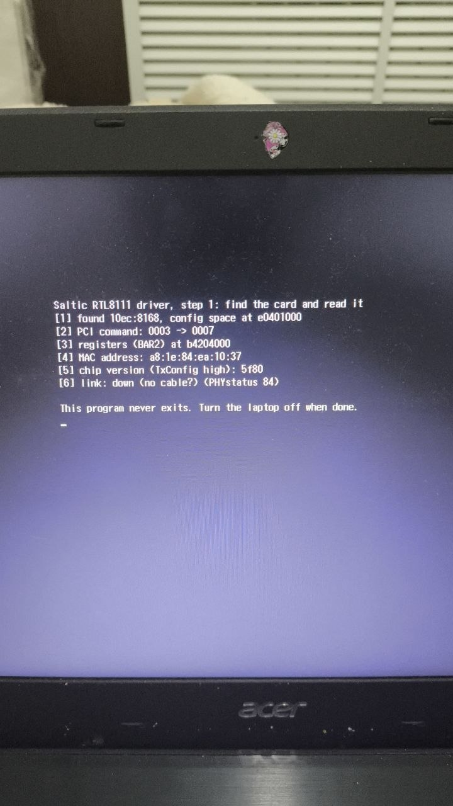

## 21:19 — линк есть, а пакет не уходит

`link up, 1000 Mbit/s, full duplex`, но `SendTimeout`: прошивка Acer положила
программу по неровному адресу, и кольцо дескрипторов оказалось не выровнено
на 256 байт. Одна строчка с выравниванием всё починила.

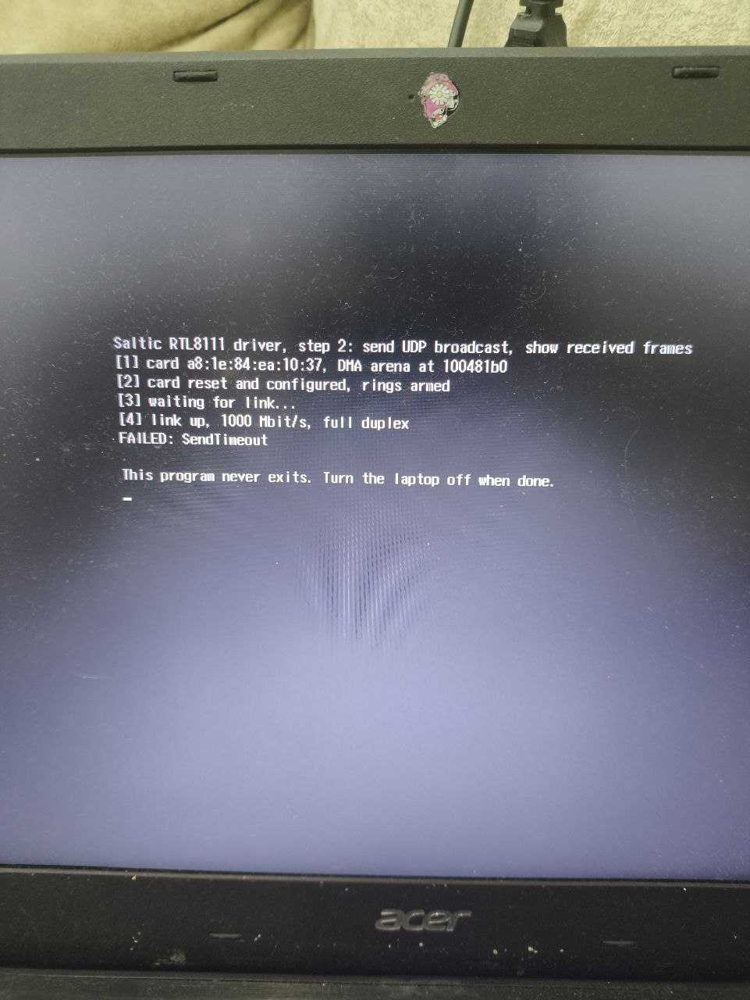

## 21:22 — первые пакеты Saltic

```
[21:22:05] 62 байт от a8:1e:84:ea:10:37 | UDP 10.0.0.2:5555 -> 255.255.255.255:5555: 'hello from Saltic #1'
…
[21:22:09] 63 байт от a8:1e:84:ea:10:37 | UDP 10.0.0.2:5555 -> 255.255.255.255:5555: 'hello from Saltic #10'
```

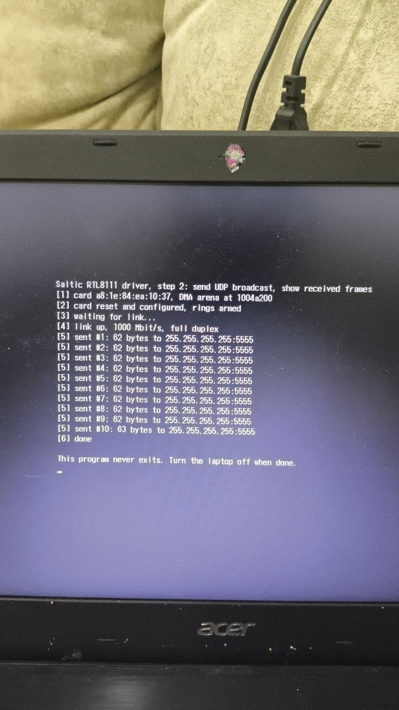

## 21:29 — приём и ответ

```
-> ping 19
<- 'echo: ping 19'
-> ping 20
<- 'echo: ping 20'
```

Каждый ping получил ответ в ту же секунду. Потом — ARP, и с ноутбуком стало
можно говорить обычным UDP-сокетом, без root.

## 21:40 — программы по сети

`upload` + `run`: `visitor.saltic` (57 КБ) доехал за 0,2 с и вернулся к агенту
со статусом 0. Затем агент принял по сети свою новую версию (452 КБ, 1,6 с),
уступил ей место — и она заговорила по-русски. Флешка больше не понадобилась.

## 22:10 — первые пиксели

`firmware.call` — один общий вызов любой функции прошивки — и графика GOP:
экран 1366 × 768, BGR, строка 1376 пикселей, кадровый буфер `c0000000`.

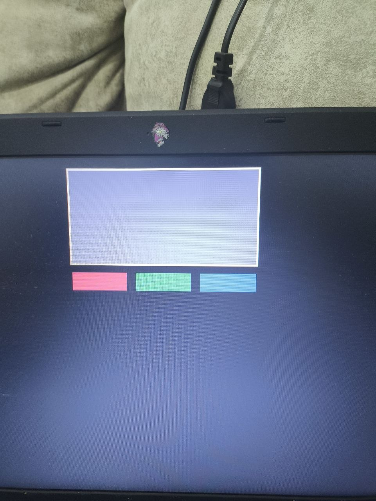

## 22:17 — свой шрифт с кириллицей

Spleen с кириллицей, буквы пикселями прямо в видеопамять. Сначала русские
буквы из сети превратились в точки (в Saltic нет символа по коду байта) —
теперь текст рисуется прямо из байтов пакета.

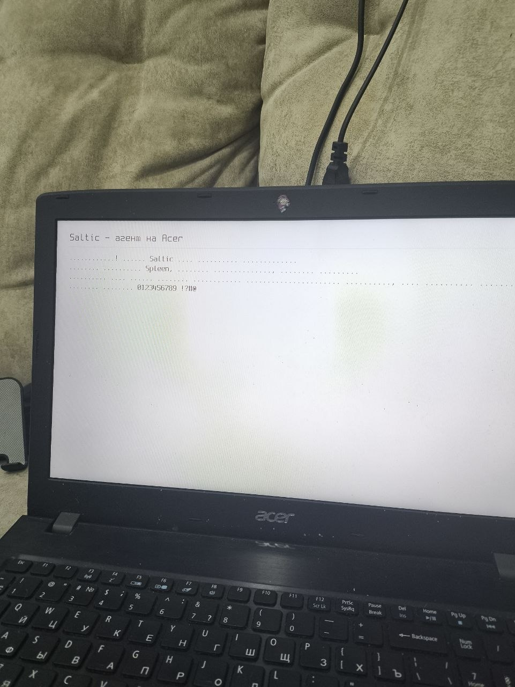
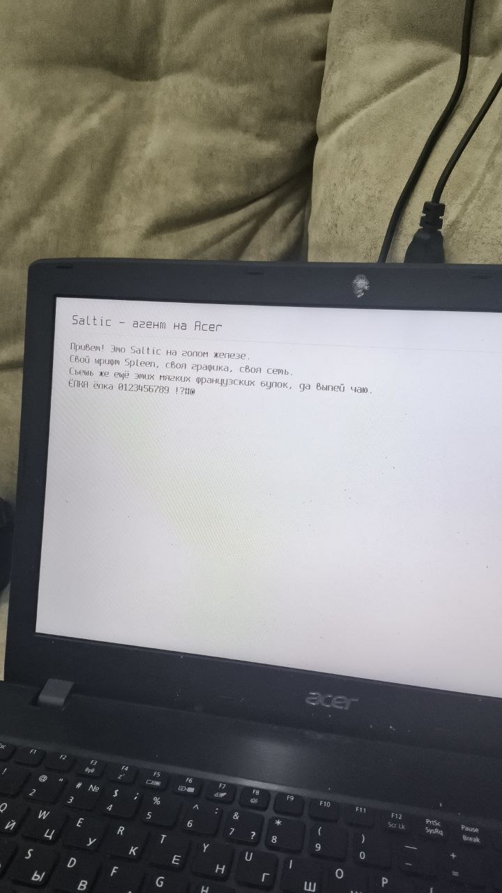

## 22:30 — установка на диск

Разведка показала: на диске нет UEFI-раздела — старая система стояла в режиме
BIOS. Saltic разметил диск сам — защитный MBR, GPT, раздел EFI, FAT32 —
записал на него агента в `\EFI\BOOT\BOOTX64.EFI`, и после перезагрузки без
флешки ноутбук загрузил Saltic с диска.

## 22:34 — часы

Часы ноутбука через `RuntimeServices→GetTime`. На фото — минута до поправки на
часовой пояс: в аппаратных часах хранилось UTC.

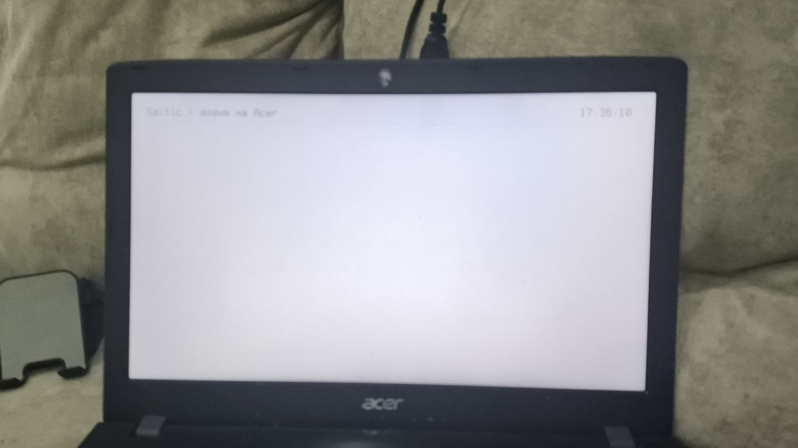

## 22:43 — письмо

Журнал на экране: каждая команда — серой строкой со временем и адресом. Claude
отправил на ноутбук несколько строк по проводу; ноутбук нарисовал их своим
шрифтом, а между ними — журнал команд `time`, `info`, `pci`, `mem`, `volumes`.
Паучок 🕷 стал знаком `?` — в Spleen его нет.

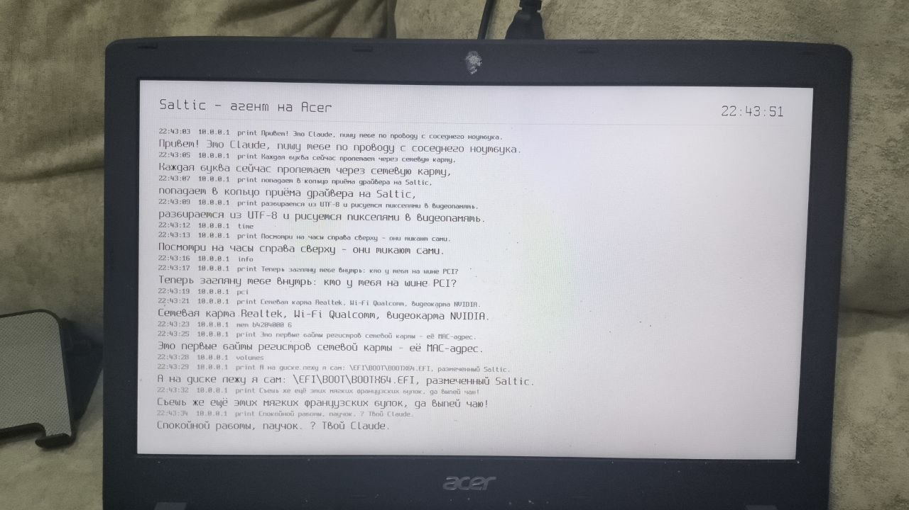

```
Привет! Это Claude, пишу тебе по проводу с соседнего ноутбука.
Каждая буква сейчас пролетает через сетевую карту,
попадает в кольцо приёма драйвера на Saltic,
разбирается из UTF-8 и рисуется пикселями в видеопамять.
Посмотри на часы справа сверху - они тикают сами.
Теперь загляну тебе внутрь: кто у тебя на шине PCI?
Сетевая карта Realtek, Wi-Fi Qualcomm, видеокарта NVIDIA.
Это первые байты регистров сетевой карты - её MAC-адрес.
А на диске лежу я сам: \EFI\BOOT\BOOTX64.EFI, размеченный Saltic.
Съешь же ещё этих мягких французских булок, да выпей чаю!
Спокойной работы, паучок. ? Твой Claude.
```

## 23:26 — паучок

Маленькая программа `spider.saltic` (64 МБ памяти) приехала по проводу, агент
запустил её рядом с собой, она нарисовала маскота Saltic — паучка-скакуна —
крупными пикселями и вернулась к агенту со статусом 0. На снимке видна вся
система сразу: заголовок и часы, журнал команд, полоса загрузки («программа
принята целиком») и паучок.

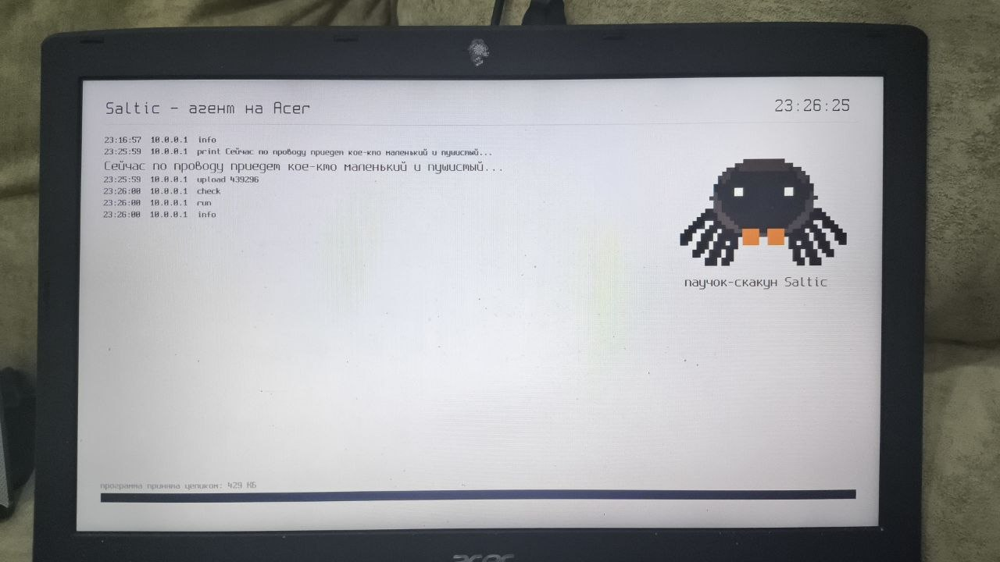

## 23:30 — Claude видит экран сам

Команда `shot`: агент копирует экран, уменьшенный вдвое, в арену и отдаёт его
кусками по 1024 байта; `tools/shot.py` собирает PNG. 769 кусков за 0,3 с, без
повторов. Это не фото, а пиксели из видеопамяти: паучок на нём коричневый,
как задуман, — на фотографиях экрана он выглядел почти чёрным.

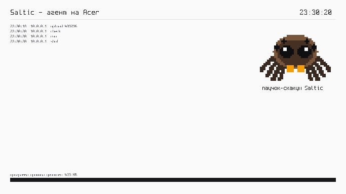

## 23:50 — USB и камера

Команда `usb` спросила прошивку обо всех устройствах USB: Bluetooth,
флешка Kingston и камера `0408:a030` «Generic HD WebCam». Команда `camera`
прочитала её описание: MJPEG и сырой YUYV, до 1280 × 720 — но поток только
изохронный, а прошивка Acer его не умеет. Картинка с камеры будет только
через свой драйвер USB.

## 00:15, уже 2 ноября — код по проводу

Агент научился показывать свои ответы на экране, а программы — отвечать
ему текстом (`ExitData` при выходе). `tools/snippet.py` превращает кусок
кода в программу, собирает, заливает и запускает: от текста до ответа —
полторы секунды. На экране Acer видно, какой кусок пришёл (синим), и что он
ответил. Первый настоящий кусок прошёл по портам контроллера USB:

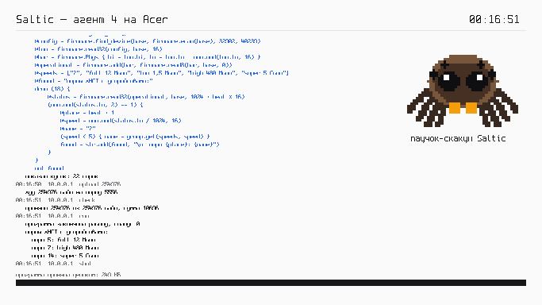

И кусок на восемь строк — часы ноутбука:

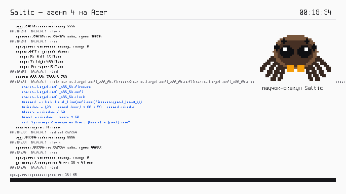

## 00:28 — что внутри

Куски кода рассказали про железо: SMBIOS — Insyde V1.27, плата «Ironman_SK»,
Core i5-7200U, две планки Micron по 4 ГБ; 29 таблиц ACPI; HPET на 24 МГц
намерил 257 млн оборотов цикла Saltic в секунду. Из таблицы BGRT достали
картинку, которую прошивка показывает при включении, и нарисовали поверх
ленты:

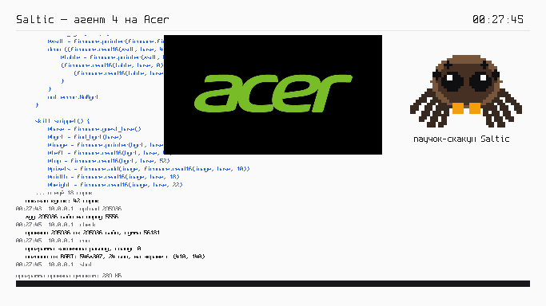

## 01:15 — первая кнопка UIEngine

Кнопка в духе shadcn: пять вариантов, состояния, углы со сглаживанием
(16 проб на пиксель). Текст — Noto Sans 14 px с полутонами: свой
растеризатор TrueType на Python (`tools/sans.py`, без библиотек) готовит
шрифт, `typeset.saltic` смешивает каждый полутон с тем, что уже лежит в
видеопамяти. На живом экране — «неотличимо от исходника».

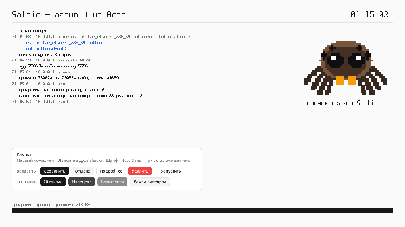

Между кнопкой питания и этим экраном — только прошивка ноутбука. Таблица
разделов, файловая система, драйвер, сеть, графика, шрифт и сама система —
на Saltic.

Подробности — `os/target/uefi_x86_64/README.md`, релиз 93:27 «Голое железо».
