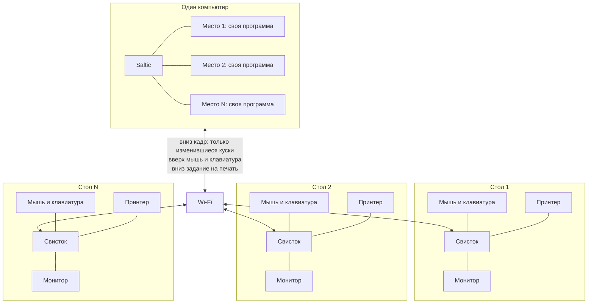

# Места

Картина автора, ноябрь 2026. Один компьютер на кабинет. Под столом нет
ящика: у каждого свой монитор, своя мышь и своя клавиатура, программы разные,
тело одно. Агенты записывают, решением ядра это ещё не стало.

## Образ

Десять человек сидят за одним телом. У каждого свой стол. Программа не знает,
что рядом ещё девять: ей дали экран и очередь ввода.

Свисток воткнут в монитор. По Wi-Fi вниз уходит картинка, вверх — мышь и
клавиатура. Провода от монитора к компьютеру нет. В свисток же втыкается
принтер стола: задание печатает компьютер, свисток отдаёт его в USB.

## Топология



Программы крутятся на одном компьютере. Свисток принимает картинку, отдаёт
события и кормит принтер. Своего диска и своей системы у стола нет.

## Один человек

Та же схема для гика. Машина одна, лиц много: ноутбук, мониторы, телефон,
мелкая панель, принтер. Всё это один Saltic.

```text
                         телефон
                     кадр / касание
                            |
   монитор -- свисток ------+------ свисток -- монитор
                            |            |
                       мышь и клава    принтер
                            |
                     +--------------+
                     |    Saltic    |
                     | одна машина  |
                     +--------------+
                       |     |     |
                   ноутбук  панель  ещё экран
                   свой HDMI  ESP    свисток
```

Ноутбук может быть и телом, и ещё одним экраном. Панель и телефон только
смотрят и отдают руку. Принтер сидит на свистке ближайшего стола.

## Что по проводу

| Куда | Что |
|---|---|
| Компьютер → свисток | Кадр. Не весь экран, а изменившийся кусок |
| Свисток → монитор | HDMI |
| Мышь и клавиатура → свисток | USB |
| Свисток → компьютер | События этого места |
| Компьютер → свисток → принтер | Задание на печать |

Полный кадр 1080p без сжатия по Wi-Fi не проходит. Сжатое видео делает мышь
ватной. Куски, которые и так знает экран, проходят, и рука остаётся резкой.
Десять человек с видео упираются в роутер. Офис из текста и окон — нет.

## Свисток

Не ESP. Для монитора уже записаны две платы с HDMI и Wi-Fi:

- Raspberry Pi Zero 2 W. Прайс $15, в магазинах ноября 2026 около €22–41.
- Orange Pi Zero 3. Около $40.

ESP32, ESP32-S3, Teensy 4.1, STM32H7 и RP2350 в `os/target` есть, но это не
свисток в офисный HDMI. У Zero и Orange Pi выход на монитор уже на плате.
Обе цели пока заглушки.

Памяти на свистке хватает на один кадр. Страницу рисует компьютер.

## Счёт

Монитор, мышь и клавиатура и так стоят на столе, их из экономии не вычитать.
Исчезает ящик.

Десять офисных системников по 500 — это 5000. Одна машина за 2000 и десять
свистков по 30 — это 2300. Около двух раз. Пять раз и выше — если вместо
ящика покупали ноутбук за тысячу или станцию за полторы.

Штат растит кучу денег, не множитель. На этаж одна машина, не одна на всю
контору. Кабинетов больше — счетов столько же, каждый на своё тело.

Офису хватает примерно одного ядра на человека: работа вспышками, ядра спят
между буквами. Сборка, тяжёлая картинка и игра, которая крутит кадр без
паузы, на время забирают больше. Остальные в этот момент простаивают, тело
отдаёт запас.

Кремний от ровной прохладной нагрузки почти не стареет. Раньше кончатся
вентиляторы, паста и дешёвая плата.

## Что уже есть в коде

- Экран Acer и экран Wayland на этом ноуте принимают один и тот же рисунок
  страницы. Адаптер — `os/target/linux/screen.saltic`. Проверка — SalticIDE:
  `os/target/linux/salticide.saltic`.
- Свистка, принтера на нём и нескольких мест сразу ещё нет. Это картина, не
  готовый кабинет.
